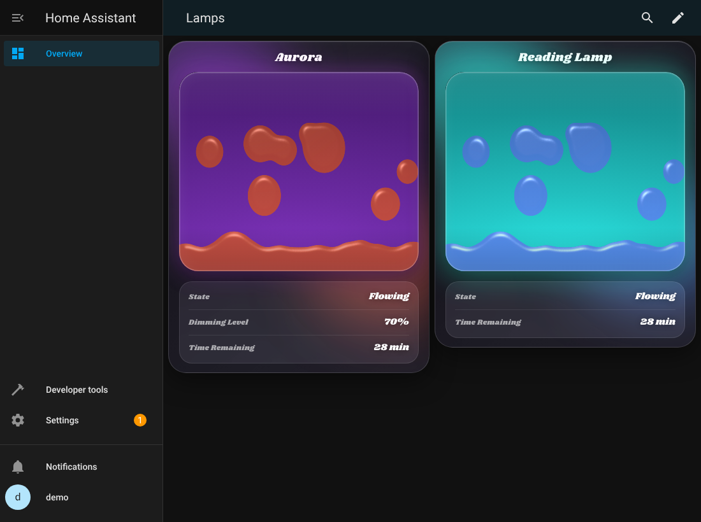
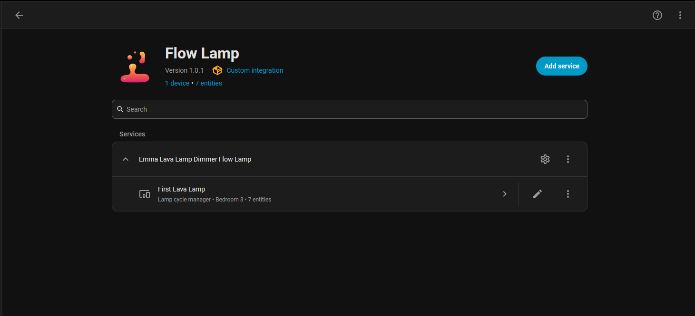
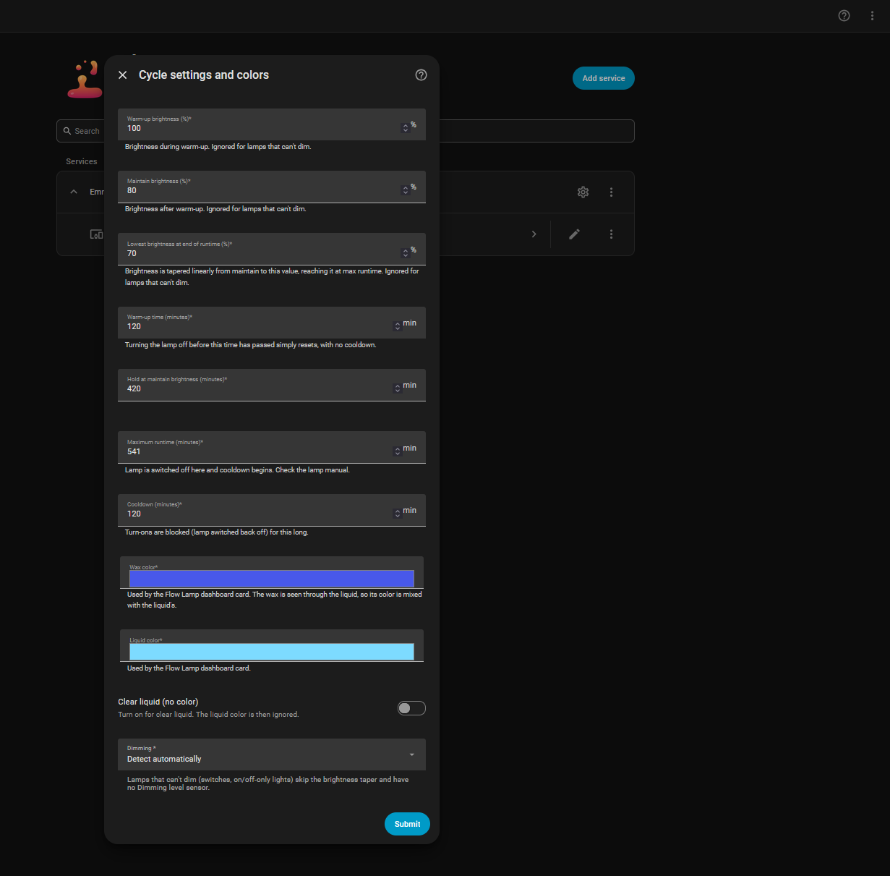
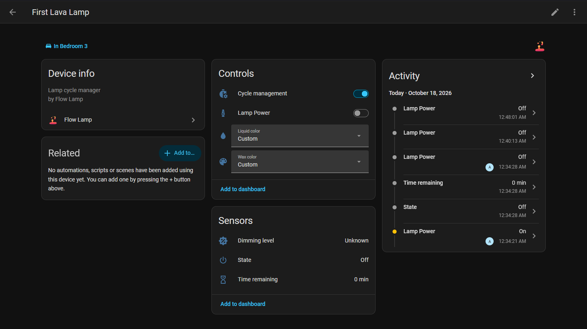
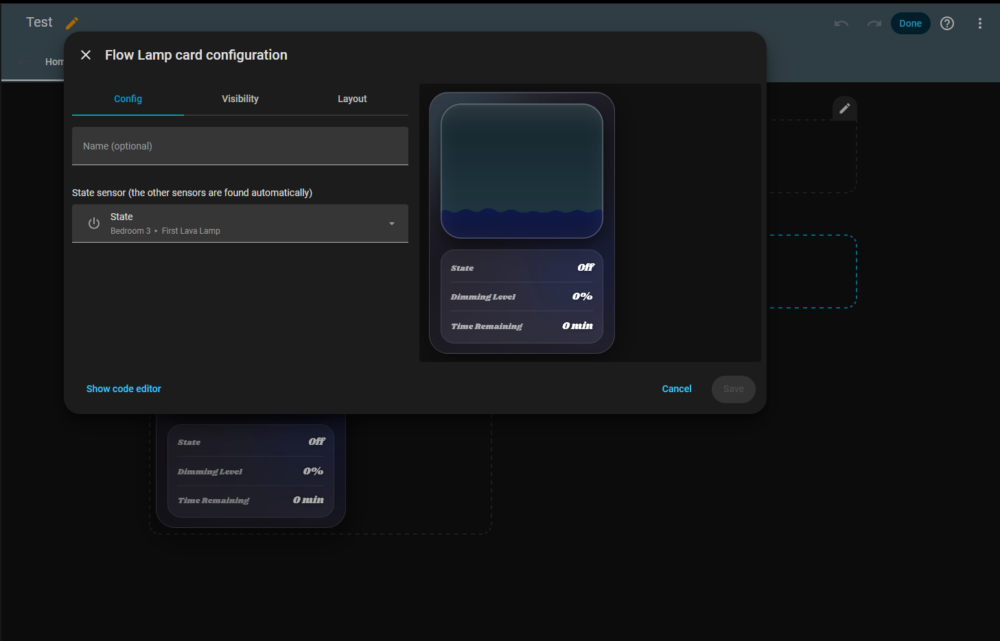
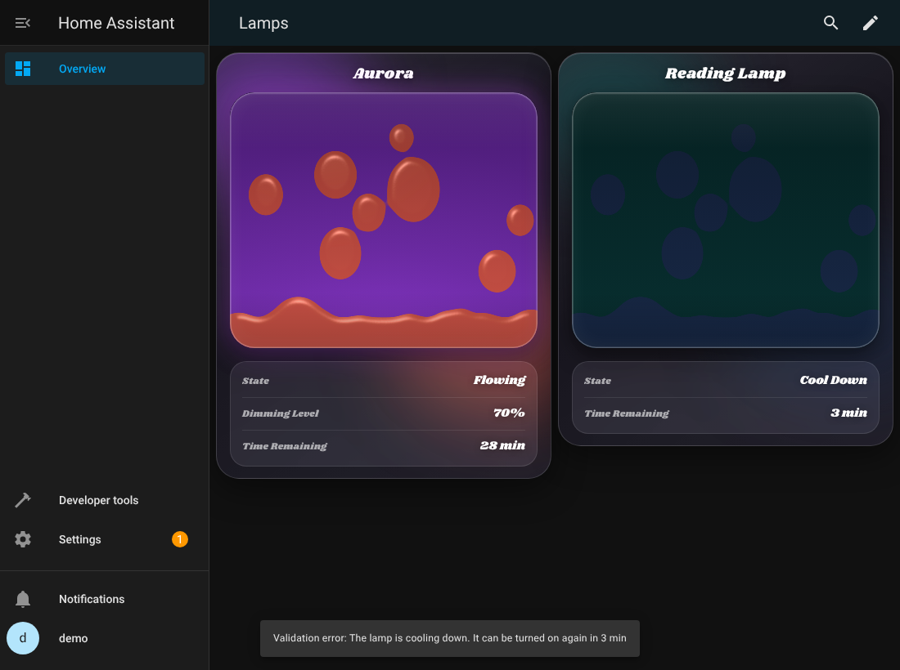
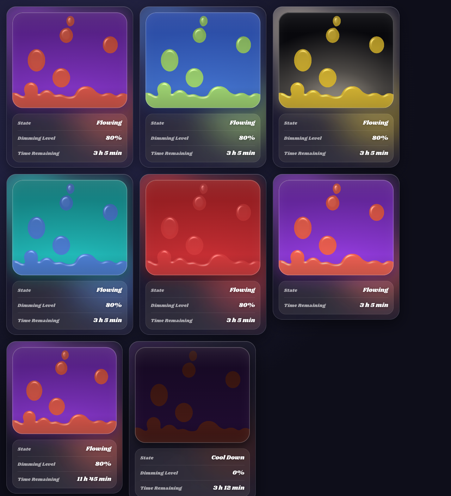

# Flow Lamp

Wax-safe runtime management for lava lamps in Home Assistant, plus an animated dashboard card.

Flow Lamp watches a dimmable light (or a plain switch) and runs the lamp through a safe cycle: **warm up, flow, then shut off before the wax is damaged and refuse to turn back on until it has cooled down**. It does this whether the lamp is turned on from Home Assistant, from the wall, or by a power-loss restore.



*The Flow Lamp card in the Flowing state. The right-hand lamp is on a plain switch, so it has no Dimming Level row.*

**Tested on Home Assistant 2026.10.1.** Earlier versions are not supported.

> Some screenshots were captured during development. The Home Assistant pages (integration, Configure, device) predate the final rename, so a few labels differ slightly from the current release.

[](https://my.home-assistant.io/redirect/hacs_repository/?owner=Fonzi03&repository=Flow_Lamp&category=integration)

## Contents

- [How a cycle works](#how-a-cycle-works)
- [Requirements](#requirements)
- [Install](#install)
- [Upgrading from the earlier "Flow" version](#upgrading-from-the-earlier-flow-version)
- [Set up a lamp](#set-up-a-lamp)
- [Entities](#entities)
- [The dashboard card](#the-dashboard-card)
- [Colors: how wax and liquid mix](#colors-how-wax-and-liquid-mix)
- [Lamps that can't dim](#lamps-that-cant-dim)
- [Automation examples](#automation-examples)
- [Safety notes](#safety-notes)
- [Troubleshooting](#troubleshooting)
- [Identifiers](#identifiers)
- [Credits](#credits)

## How a cycle works

| Phase | What happens |
|---|---|
| **Warm Up** | Lamp is on at the warm-up brightness for the warm-up time. |
| **Flowing** | Brightness holds at the maintain level, then tapers smoothly to the lowest level, reaching it at the maximum runtime. This stretches the runtime without stalling the wax. |
| **Shut off** | At the maximum runtime the lamp is switched off and the cooldown starts. |
| **Cool Down** | Any turn-on (wall switch, app, voice, power restore) is switched straight back off until the cooldown ends. |
| **Off** | Cooldown over. The next turn-on starts a new cycle. |

Details worth knowing:

- Turning the lamp off **before warm-up finishes** just resets the cycle, with no cooldown. Turning it off after warm-up starts the full cooldown.
- A local turn-on starts a cycle too, so the wall switch is covered.
- Manual dimming is corrected at the next one-minute check.
- The cycle and cooldown are saved, so a Home Assistant restart doesn't reset them. If Home Assistant was down long enough for the runtime to expire, the lamp is switched off when it comes back.
- The defaults (90 min warm-up, 60 min hold, 480 min runtime, 240 min cooldown) are placeholders. **Check your lamp's manual for its maximum runtime and cooldown.**

## Requirements

- **Home Assistant 2026.10.1** (the version this release was developed and tested on).
- A `light` entity (dimmable or not) or a `switch` entity that powers the lamp.
- A lamp bulb the dimmer can handle. Lava lamp bulbs are small incandescents, below the minimum load of some Zigbee dimmers. If you see flicker or buzzing, look for a minimum-brightness or bulb-type setting in your dimmer's integration.
- Home Assistant 2026.3 or newer is needed for the integration icon to show (it ships as a local brand image).

## Install

**Manual**

1. Unzip `flow-lamp-<version>.zip` into `config/custom_components/`. You should end up with `config/custom_components/flow_lamp/manifest.json` and `config/custom_components/flow_lamp/www/flow-lamp-card.js`.
2. Restart Home Assistant fully (a reload is not enough).
3. Hard-refresh your browser (Ctrl+Shift+R). In the mobile app, force-close it or clear its frontend cache.

**HACS (custom repository)**

Add this repository as a custom repository of type *Integration*, install **Flow Lamp**, then restart and hard-refresh as above.

The integration registers its dashboard card as a resource automatically (`/flow_lamp_static/flow-lamp-card.js`). If your dashboard resources are defined in YAML, Home Assistant doesn't let integrations edit them. Flow Lamp then falls back to loading the card as an extra frontend module, and you can also add that URL as a JavaScript module resource yourself.

## Upgrading from the earlier "Flow" version

Flow Lamp is a rename, so it installs next to the old one rather than over it. To switch:

1. Remove the old **Flow** entries (Settings, Devices & services, Flow, delete each entry).
2. Delete the old `config/custom_components/flow` folder.
3. Delete the old dashboard resource `/flow_static/flow-card.js` (Settings, Dashboards, Resources) if it is still listed.
4. Install Flow Lamp as above, restart, and add your lamps again.
5. Replace any `custom:flow-card` cards with the **Flow Lamp** card (`custom:flow-lamp-card`). Entity IDs change too, for example `sensor.aurora_lamp_flow_state` becomes `sensor.aurora_lamp_flow_lamp_state`, so update automations that use them.

## Set up a lamp

Settings, Devices & services, **Add integration**, **Flow Lamp**. Add one entry per lamp.

| Field | Meaning |
|---|---|
| Lamp | The light or switch that powers the lamp |
| Warm-up brightness / time | Brightness during warm-up, and how long it lasts |
| Maintain brightness / hold | Brightness after warm-up, and how long it is held before tapering |
| Lowest brightness | Where the taper ends, reached at the maximum runtime |
| Maximum runtime | The lamp is switched off here. Must be at least warm-up time plus hold time; if it is exactly equal there is no taper phase and the lamp runs at the maintain brightness until shut-off. |
| Cooldown | How long turn-ons are blocked afterwards |
| Wax color / Liquid color | Used by the dashboard card |
| Clear liquid | Turn on for clear (uncolored) liquid |
| Dimming | *Detect automatically*, *Dimmable*, or *On/off only* |

Change any of these later with **Configure** on the entry. Color-only changes apply instantly without a reload. **This is the only place card colors are set**, along with the color selects below.





## Entities

Each lamp becomes one device with these entities. Entity IDs follow your lamp's name, for example `sensor.aurora_lamp_flow_lamp_state`.

| Entity | Type | Purpose |
|---|---|---|
| State | sensor | **Off**, **Warm Up**, **Flowing**, **Cool Down**. The maintain hold and the taper both count as Flowing. |
| Dimming level | sensor (%) | The actual dimmer output, read from the light. Only exists for lamps that can dim. |
| Time remaining | sensor | Runtime left (Warm Up and Flowing) or cooldown left (Cool Down). Shows `45 min` up to 59 minutes, then `1 h 30 min`. |
| Lamp Power | switch | Turns the lamp on or off. Turning it on during cooldown is refused, and Home Assistant shows a message saying how long is left. |
| Cycle management | switch | Turns Flow Lamp's management of this lamp on or off. Turning it off drops the current cycle. |
| Wax color | select | Preset wax colors. Shows **Custom** if you set an exact color in Configure. |
| Liquid color | select | **Clear** or a preset liquid color. Shows **Custom** for exact colors. |



The State sensor also carries attributes: `light`, `dimmable`, `cycle_start`, `cooldown_until`, `wax_color`, `liquid_color`, `liquid_clear`.

## The dashboard card

Add it from the card picker as **Flow Lamp**, or in YAML:

```yaml
type: custom:flow-lamp-card
state_entity: sensor.aurora_lamp_flow_lamp_state   # the only required option
name: Aurora                                       # optional title
```

The dimming and time-remaining sensors and the Lamp Power switch are found automatically from the same Flow Lamp device, so you only choose the State sensor. The picker only lists Flow Lamp entities. The card has no color settings: it uses the wax and liquid colors from the integration.



**What the animation does**

| State | Animation |
|---|---|
| Warm Up | Lamp lit, wax resting at the bottom |
| Flowing | Lit, wax blobs slowly rise and sink |
| Cool Down | Unlit, wax still flowing |
| Off | Wax sinks back to the bottom and the light stays off |

The backlight follows the dimming level, so a lamp dimmed to 45% looks dimmer. The light comes from the bottom of the lamp, like a real one: the wax near the base shows more of its own color and shifts toward its liquid-tinted color over about the first quarter of the height. Motion is deliberately slow and flowy, with an occasional quicker blob, and a little slower again on small screens.

**Tap the animation to turn the lamp on or off.** If the lamp is cooling down, Home Assistant shows its message instead of turning it on.



**Layout.** The card looks best about 7 columns wide in a sections dashboard (its default). In narrower spaces, a row whose text doesn't fit drops its value onto a second line instead of overflowing.



## Colors: how wax and liquid mix

The lamp's bulb shines up through the liquid, so the **liquid tints the wax**, like a real lava lamp. The card works the same way: the wax you see is the wax color seen through the liquid color, and the glow behind the tank takes on the liquid's color too. Nothing is hard-coded to orange or red.

Because the light comes from the bottom, the wax close to the bulb still shows mostly its own color and fades to the tinted color over roughly the first 25% of the height.

| Wax | Liquid | Wax looks |
|---|---|---|
| Yellow | Purple | Yellow at the base, fading to orange-red |
| Yellow | Blue | Yellow at the base, fading to green |
| Yellow | Clear | Yellow throughout |
| Pink | Teal | Blue |
| White | Red | Red |

Strongly saturated liquids pass little other light, so very different combinations can look dark. Clear liquid lets the wax keep its own color and gives a white backlight. Change colors from the Wax color and Liquid color selects on the device page (presets), or with **Configure** (exact colors and the clear-liquid toggle).


## Lamps that can't dim

Point Flow Lamp at a plain `switch` (smart plug) or an on/off-only light. Everything else keeps working: the warm-up, flowing, shut-off and cooldown phases, the time remaining, the Lamp Power switch and the card. There is no brightness taper, because there is nothing to dim, and no Dimming Level sensor or card row. The card's backlight is simply on whenever the lamp is on.

The Dimming setting defaults to **Detect automatically**. Force **On/off only** if a light reports brightness but is really driving a plug.

## Automation examples

Notify when the lamp can be used again:

```yaml
alias: Lava lamp ready again
triggers:
  - trigger: state
    entity_id: sensor.aurora_lamp_flow_lamp_state
    from: cool_down
    to: "off"
actions:
  - action: notify.notify
    data:
      message: "The lava lamp has cooled down and is ready."
```

Turn the lamp on each evening, but only when it is allowed to run:

```yaml
alias: Lava lamp evening
triggers:
  - trigger: time
    at: "18:00:00"
conditions:
  - condition: state
    entity_id: sensor.aurora_lamp_flow_lamp_state
    state: "off"
actions:
  - action: switch.turn_on
    target:
      entity_id: switch.aurora_lamp_flow_lamp_lamp_power
```

## Safety notes

- Flow Lamp enforces the limits through Home Assistant. **If Home Assistant or your Zigbee network is down while the lamp is on, nothing enforces the runtime.** If your dimmer has a device-level auto-off timer, set it a little above your maximum runtime as a backstop.
- Disabling **Cycle management** stops all protection for that lamp.
- Check your lamp's manual for safe runtime and cooldown, and set them accordingly.

## Troubleshooting

| Problem | Fix |
|---|---|
| The card isn't in the picker | Restart Home Assistant (not just reload), then hard-refresh the browser. Check Settings, Dashboards, Resources for `/flow_lamp_static/flow-lamp-card.js`. |
| The picker shows a loading icon forever | The resource URL must be exactly `/flow_lamp_static/flow-lamp-card.js` with **no** `?v=` suffix. Flow Lamp registers it that way and corrects it at startup. |
| `/flow_lamp_static/flow-lamp-card.js` gives a 404 | The card is served once the integration has loaded. Make sure at least one lamp is set up and Home Assistant was fully restarted. |
| The integration icon is the old one or missing | Local brand icons need Home Assistant 2026.3 or newer. Then restart and hard-refresh. |
| The version shown doesn't match the zip | The old files are still in place. Delete `config/custom_components/flow_lamp` first, then unzip so that `manifest.json` ends up directly inside `flow_lamp`. |
| There's no Dimming Level on the card | The lamp is a switch or an on/off-only light, or Dimming is set to *On/off only*. This is expected. |
| A lamp turned on during cooldown goes straight back off | That is the protection working. Check **Time remaining**. |
| Colors on the card don't change | Colors are set in the integration (Configure, or the Wax color and Liquid color selects), not on the card. |

## Identifiers

For reference: the integration domain and folder are `flow_lamp`, the card type is `custom:flow-lamp-card`, and the card file is served from `/flow_lamp_static/flow-lamp-card.js`.

## Credits

- The card embeds the Shrikhand font, licensed under the SIL Open Font License 1.1 (see `custom_components/flow_lamp/www/LICENSE-Shrikhand.txt`).
- Icon source: `assets/icon.svg`.
